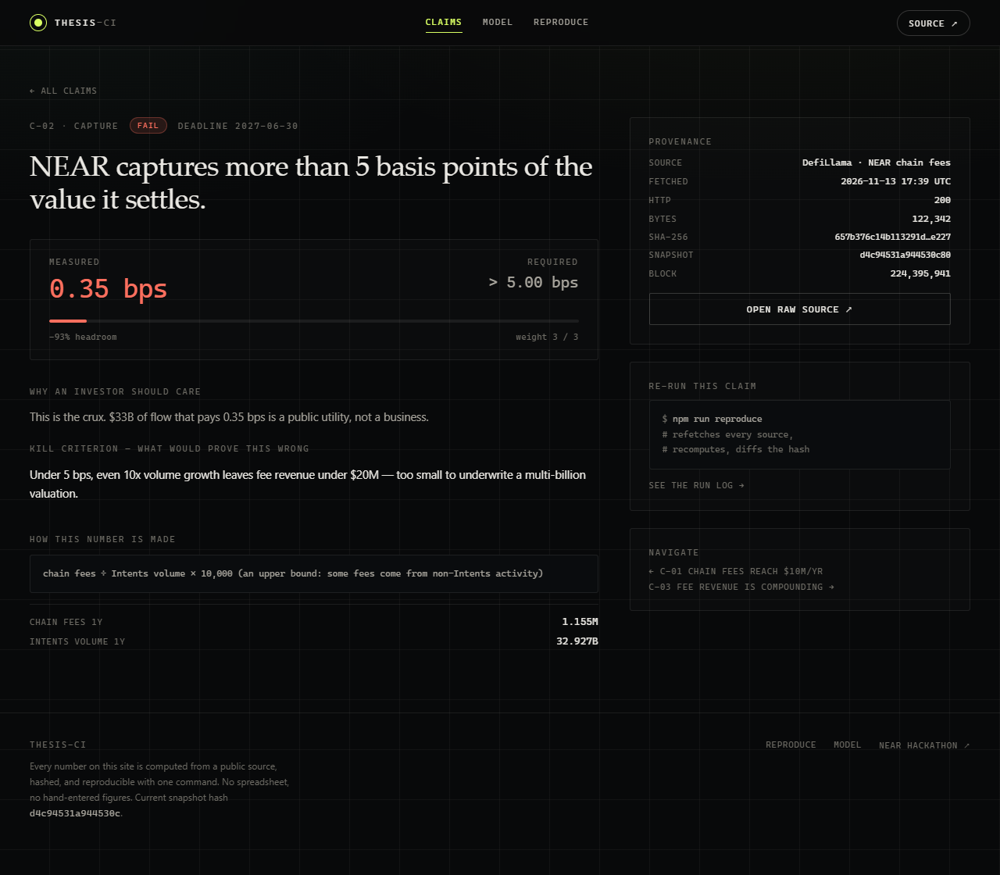

# thesis-ci

**The NEAR thesis, as a test suite.**

Fourteen falsifiable claims about NEAR. Each one is computed from a public data source, hashed with SHA-256, and reproducible with one command. Every claim carries the criterion that would prove it wrong.

Built for **NEAR HACKATHON** — tracks: **Investment Thesis**, **Open Innovation**.

**Repo:** [github.com/mahadiul-hasan/thesis-ci](https://github.com/mahadiul-hasan/thesis-ci)

| The scorecard | A claim that fails |
|---|---|
|  |  |

---

## The finding, in one box

| | |
|---|---|
| NEAR Intents settled, trailing 12 months | **$32.93B** |
| NEAR chain fees captured, trailing 12 months | **$1.15M** |
| Take rate on settled volume | **0.35 basis points** |
| Market cap ÷ annualised fees | **3,998×** |
| Claims holding | **4 of 14** |

NEAR moves roughly thirty-three billion dollars a year and keeps about thirty-five thousandths of one percent of it.

That is not a bearish conclusion, it is a description of **which** thesis is actually true. NEAR today is not a fee business. It is an option on becoming one, priced at 3,998× annual fees. The interesting question — the one this project tries to answer with numbers instead of conviction — is whether that option is being exercised, quarter by quarter.

Most submissions in this track will be a dashboard showing that NEAR is good. This is a scorecard that says **which parts are good, which parts are failing, and what would have to change.**

---

## Try it

Five minutes, no keys, no accounts.

### 1. Install

```bash
npm install
```

**Expect:** packages install, no errors.

### 2. Run

```bash
npm run dev
```

Open <http://localhost:3000>.

**Expect:** the hero reads `$32.93B` settled, `$1.15M` captured, `0.35 bps` take rate, and a verdict strip showing `4 / 14` claims holding.

### 3. Open a failing claim

Click **C-02 · NEAR captures its own flow**.

**Expect:** measured `0.35 bps` against a required `> 5.00 bps`, a **FAIL** pill, `-93% headroom`, the exact formula `chain fees ÷ Intents volume × 10,000`, both raw inputs, and the SHA-256 fingerprint of the DefiLlama payload the number came from.

### 4. Move the model

Go to **Model**. Drag **take rate** from `0.35 bps` to `5.00 bps`.

**Expect:** implied value jumps from about `$150M` to about `$2.14B` — and is **still below** the `$4.62B` market cap. Then read the line underneath: at a 100× multiple, today's price requires a take rate of roughly **10.8 bps**, thirty times what the network currently captures.

### 5. Reproduce it

```bash
npm run reproduce
```

**Expect:** `check 1 integrity OK`, then all ten sources refetched with fresh fingerprints, then a field-by-field diff of every metric that moved, ending in `HASH MATCH` or a named `DRIFT`.

### 6. Read it as data

```bash
curl -s localhost:3000/api/claims | head -c 400
curl -s localhost:3000/api/snapshot -D - -o /dev/null | grep -i snapshot-hash
```

**Expect:** JSON with `summary.pass = 4`, and an `x-snapshot-hash` response header matching the hash printed on `/reproduce`.

---

## Why this is not another NEAR dashboard

Three things, in order of how much they matter.

**1. The thresholds were written before the numbers were read.**
They live in [`src/lib/claims.ts`](src/lib/claims.ts). Moving a threshold after seeing the data is a visible git diff, not a quiet edit. That is the difference between a thesis and a press release.

**2. Every number is fingerprinted.**
Each HTTP response is hashed at fetch time. The snapshot hash commits to the sources *and* the derived metrics, so a re-run either reproduces it exactly or shows you precisely what moved. There is no hand-entered figure anywhere in this repository.

**3. It is designed to lose.**
Every claim has a kill criterion. The site reports 10 of 14 claims failing, because they are. A tool that can only produce good news is not an analytical instrument.

---

## The claims

Snapshot `snapshot-2026-11-13`, block `224,395,941`.

| # | Claim | Measured | Required | Status |
|---|---|---|---|---|
| F-01 | Intents settles at scale | $32.93B | > $10B / yr | **PASS** |
| F-02 | Flow is compounding | −21.6% | > +10% MoM | FAIL |
| C-01 | Chain fees reach $10M/yr | $1.15M/yr | > $10M / yr | FAIL |
| C-02 | NEAR captures its own flow | 0.35 bps | > 5.00 bps | FAIL |
| C-03 | Fee revenue is compounding | −32.2% | > +20% MoM | FAIL |
| C-04 | Valuation is underwritten by fees | 3,998× | < 500× | FAIL |
| D-01 | Capital is parked on NEAR | $162.16M | > $500M | FAIL |
| D-02 | NEAR is a top-15 chain by TVL | 21 | rank ≤ 15 | FAIL |
| D-03 | Dollar rails have depth | $132.03M | > $500M | FAIL |
| D-04 | Dollar rails are growing | −3.4% | > +20% · 90d avg | FAIL |
| D-05 | Capital is arriving, not leaving | +55.9% | > +10% · 90d avg | **PASS** |
| N-01 | The validator set is wide | 354 | > 400 | FAIL |
| N-02 | Stake is not concentrated | 35.9% | < 40% | **PASS** |
| B-01 | The protocol is still being built | ≥100 | ≥ 100 / 30d | **PASS** |

The pattern is the argument: **flow and capital are arriving; capture is not.** Intents settles at scale, TVL trend is up 56%, the validator set is not concentrated, and the protocol still ships. Meanwhile the network captures a third of a basis point, fees fell 32% month over month, and the valuation is four thousand times revenue.

The site closes with a section that states the bull case fairly — what NEAR is actually winning, and the four numbers that would flip the verdict. A scorecard that only lists failures is a hit piece, not an instrument.

### Two methodological choices worth defending

- **90-day averages, not point-to-point.** NEAR TVL went from $54.6M to $162.2M over 90 days — but it was $243.1M a month ago. Point-to-point changes on that series are cherry-pickable in either direction. Claims D-04 and D-05 compare two adjacent 90-day means instead.
- **Commit counts are a floor.** The GitHub API caps a page at 100, so `B-01` reads `≥ 100`, not `100`.

---

## The model

```
implied FDV = projected annual volume × take rate × fee multiple
```

One line, no spreadsheet, no hidden tabs. It lives in [`src/lib/model.ts`](src/lib/model.ts) and runs in the browser, so the reader can change any assumption and watch the valuation move.

The output that matters is the inverse: **what the market is being asked to believe.** At a 100× fee multiple, today's $4.62B market cap requires a take rate near **10.8 bps**. NEAR captures **0.35 bps**. That gap is the entire investment question, stated as a number.

The model page also lists three things it does **not** claim:

1. Chain fees are not all Intents fees, so the take rate is an *upper bound* on Intents-derived capture. The real capture is lower.
2. A fee multiple is a convention, not a derivation — which is why it is a slider.
3. If NEAR's value comes from being the reserve asset of an agent economy rather than from fee cash flow, this model measures the wrong thing. Saying that out loud is part of the thesis.

---

## How it works

```
public APIs ──► fetch + sha256 each payload ──► computeMetrics() ──► snapshot
                                                                       │
                                        ┌──────────────────────────────┤
                                        ▼                              ▼
                                 claims engine                  series for charts
                                        │
                                        ▼
                              Next.js static pages  +  /api/snapshot  +  /api/claims
```

- `scripts/collect.ts` — fetches all sources, fingerprints them, computes metrics, writes `data/snapshots/<date>.json` and `data/latest.json`. It is not wired to an npm script on purpose: the committed snapshot is the artefact under test, and one stray command should not be able to rewrite it.
- `src/lib/metrics.ts` — every formula, with its inputs recorded alongside the result.
- `src/lib/claims.ts` — the pre-registered thresholds and the pass/fail evaluator.
- `src/lib/model.ts` — the valuation function.
- `src/lib/hash.ts` — canonical JSON + SHA-256, so the same numbers always produce the same hash.

No database, no cron, no server state. The snapshot is a file in git.

---

## Reproducibility

```bash
npm run reproduce    # rehash the committed snapshot, then refetch and diff it
```

To build a *new* snapshot, run the collector directly — `npx tsx scripts/collect.ts`. It is deliberately not an npm script, because it overwrites the committed data and the hash under test.

A snapshot is a photograph, not a live feed. Re-running later is *expected* to show drift — the point is that the drift is visible, attributed to a field, and quantified. If you re-run against unchanged inputs you get the same hash; if you do not, the diff tells you exactly which source moved.

`npm run reproduce` runs two independent checks:

- **Check 1 — integrity, offline.** It rehashes the committed snapshot from its own contents and must reproduce the hash exactly. No network, no clock. This is what proves the file was not edited after collection.
- **Check 2 — live drift.** It refetches every source, recomputes every metric, and names each field that moved and by how much.

Check 1 always passes on an untouched repository. Check 2 usually drifts, because prices move — and that drift is the honest part.

The hash covers:

```
sha256( canonicalJson({ chain, metrics, sources }) )
```

---

## NEAR features used

| Feature | Where |
|---|---|
| **NEAR JSON-RPC (mainnet)** | `status` for block height and protocol version; `validators` for the active set, total stake and top-10 concentration — feeds claims N-01, N-02 |
| **NEAR account model** | payout address is a named mainnet account; all stake figures are yoctoNEAR normalised to NEAR |
| **NEAR Social (`social.near`)** | optional on-chain attestation of each snapshot hash — `npm run attest` (see below) |
| **NEAR ecosystem data** | NEAR Blocks for market cap, supply, price and transaction totals |

There is deliberately **no custom smart contract**. The Investment Thesis track is a data-and-evidence track, and a contract would have been decoration. Every NEAR read above is a live mainnet call made at collection time and hashed into the snapshot.

### Optional: on-chain attestation

```bash
# .env.local
NEAR_ACCOUNT_ID=you.near
NEAR_PRIVATE_KEY=ed25519:...
```

```bash
npm run attest
```

Writes the snapshot hash to `social.near` from your account and appends the transaction hash to `data/attestations.json`, which `/reproduce` renders as a link on NEAR Blocks. This makes the snapshot timestamp tamper-evident: a hash committed to a public chain cannot be backdated.

If you never run it, `/reproduce` says so plainly and falls back to the git commit time. Nothing is faked.

---

## Data sources

All public, all free, no API keys.

| Source | Used for |
|---|---|
| [DefiLlama](https://defillama.com) — chain fees, Intents volume, chain TVL, stablecoin supply, fee/TVL rankings | F-01, F-02, C-01…C-04, D-01…D-05 |
| [NEAR Blocks](https://nearblocks.io) | market cap, price, supply, transaction totals |
| [NEAR RPC](https://docs.near.org/api/rpc/providers) | block height, protocol version, validator set |
| [GitHub API](https://docs.github.com/rest) | nearcore commit velocity |

---

## Project layout

```
data/
  latest.json              pointer to the current snapshot
  snapshots/               immutable snapshots, one per collection
  runs.json                append-only run log
  attestations.json        on-chain attestations, if any
scripts/
  collect.ts               fetch → fingerprint → compute → write (run directly)
  reproduce.ts             rehash offline, then refetch → recompute → diff
  attest.ts                publish the snapshot hash to NEAR
src/
  app/                     pages: claims, claim detail, model, reproduce, API
  components/              chart, claim card, model workbench, chrome
  lib/                     claims, metrics, model, hashing, sources
```

---

## Limitations

- **Chain fees ≠ Intents fees.** The take rate is an upper bound. Stated on the model page and in the metric's own `method` field.
- **DefiLlama is a single point of failure.** If its methodology changes, the numbers move. The fingerprints make that visible rather than silent.
- **Fourteen claims is not a complete thesis.** It is the subset that a public number can settle this week. The gaps — developer retention, agent revenue, token supply policy — are named rather than hidden.
- **Commit velocity is a weak proxy** for conviction, and it is capped at 100 by the API.

---

## License

MIT. See [LICENSE](LICENSE).
